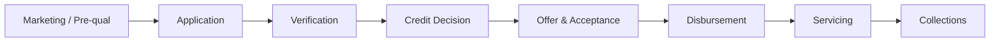

# Domain Overview — Credit & Lending

## 1. Value Chain

## 2. Product Definition — Personal Loan

| Attribute | Value |
|-----------|-------|
| Principal | €2,000 – €35,000 |
| Term | 12 – 60 months |
| Rate type | Fixed APR |
| Repayment | Monthly direct debit |
| Security | Unsecured |

## 3. Decision Components

| Component | Owner | Output |
|-----------|-------|--------|
| Eligibility rules | Risk | Pass / Fail / Refer |
| Credit scorecard | Data Science | PD band, score 300–850 |
| Affordability | Risk + Compliance | Max installment cap |
| Pricing | Finance | APR tier |
| Fraud checks | Financial Crime | Device/identity flags |

## 4. Channel Requirements

| Channel | Capture | E-signature | Funds delivery |
|---------|---------|-------------|----------------|
| Mobile app | Full STP target | In-app | Same-bank instant / SEPA 1d |
| Web | Full STP | Click-wrap + OTP | SEPA |
| Branch | Assisted data entry | Wet sign optional | SEPA |

## 5. Regulatory Disclosures (EU)

- Pre-contractual SECCI / ESIS equivalent
- 14-day right of withdrawal post-disbursement (jurisdiction-dependent)
- APR and total cost of credit prominently displayed

## 6. KPIs

| KPI | Target |
|-----|--------|
| Application-to-decision (STP) | < 60 seconds |
| Pull-through (approved → funded) | ≥ 72% |
| Early delinquency (30 DPD @ 6mo) | < 2.5% |
| Complaint rate (mis-selling) | < 0.1% of funded loans |
