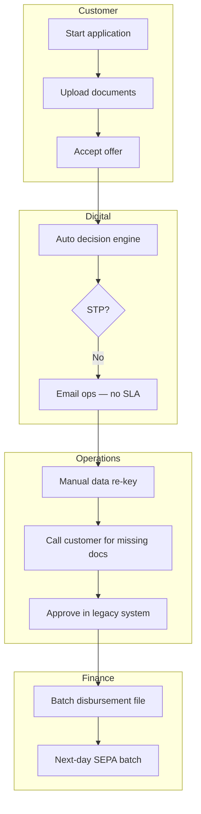

# As-Is Process Analysis — Loan Origination

## Swimlane — Application to Funding

## Pain Points

| ID | Description | Impact |
|----|-------------|--------|
| PP-L01 | 34% applications leave digital journey for manual ops | Cost €18/app avg |
| PP-L02 | Offer expiry not enforced — rate drift | Revenue leakage |
| PP-L03 | Disbursement batch once daily | Poor CX vs competitors |
| PP-L04 | No single application ID across bureau + core | Reconciliation errors |

## Bottleneck Analysis

Average manual path: **4.2 days** vs STP path: **47 minutes**.  
Primary delay: document re-request loop (62% of manual cases).
