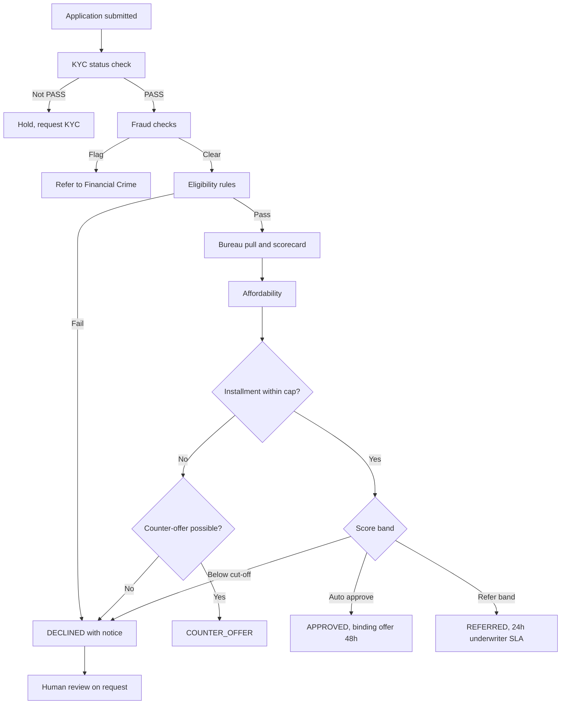
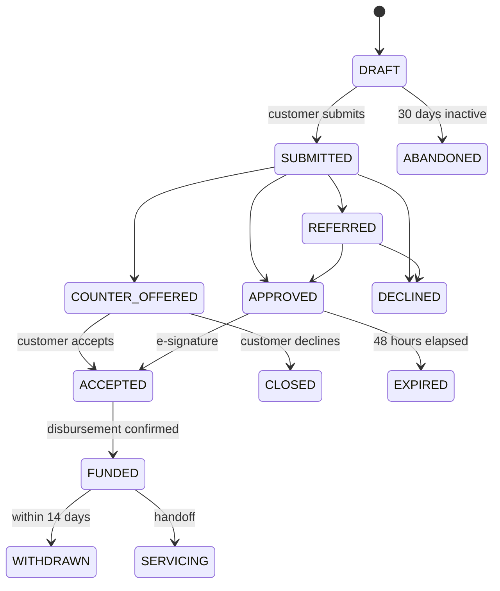

# To-Be Process Design: Aurora Lending Origination v2

Extends the [BRD](03-business-requirements-document.md). The approved BRD stays as the baseline; the change requests below record gaps found during requirements review. Regulatory points are working assumptions, to be confirmed by Legal for each jurisdiction.

## 1. Requirements Review Findings

| ID | Finding | Evidence | Resolution |
|----|---------|----------|------------|
| F-01 | A fully automated decline has no route to human review. GDPR Article 22 applies to such decisions, and the CJEU SCHUFA ruling (C-634/21) treated credit scoring as covered where it is decisive | BRD section 3 | CR-01 adds a review request path |
| F-02 | "Adverse action" is US terminology. In the EU, the applicant must be told when a decline is based on a database consultation | Glossary, FR-07 | CR-02 restates the requirement |
| F-03 | Declared expenses are accepted as stated, so an applicant can understate them and pass affordability | BR-LEND-01 | CR-03 applies a living-cost floor |
| F-04 | Open banking or payslip verification does not fit self-employed and retired applicants, though both are valid employment types | BRD section 2 | CR-04 defines income evidence by type |
| F-05 | The withdrawal right is in the domain overview, with no requirement behind it. Same-day funding makes this a live case | Domain Overview section 5 | CR-05 adds FR-09 |
| F-06 | A 30-day save and resume conflicts with bureau data age | FR-08 vs FR-02 | CR-06 refreshes data older than 7 days |
| F-07 | Revised Consumer Credit Directive (EU) 2023/2225 applies from 20 November 2026 and tightens creditworthiness assessment | BRD scope | CR-07 adds a compliance checkpoint |

## 2. Change Requests

| CR | Rule or Requirement | Statement |
|----|---------------------|-----------|
| CR-01 | FR-10 (Must) | Every automated decline SHALL give the applicant a route to request human review, with a decision in 5 business days. |
| CR-02 | FR-07 (amended) | The decline notice SHALL state the main reasons and, where relevant, the database consulted. |
| CR-03 | BR-LEND-01 (amended) | `essential_expenses = max(declared, living_cost_floor)` for household size and region. |
| CR-04 | BR-LEND-02 | Income evidence by employment type, see section 3. |
| CR-05 | FR-09 (Must) | The system SHALL support withdrawal within 14 days, including payoff calculation. |
| CR-06 | BR-LEND-03 | Bureau and income data older than 7 days at submission SHALL be refreshed, with fresh consent. |
| CR-07 | Checkpoint | Legal SHALL review affordability and disclosure rules against national transposition before go-live. |

## 3. Income Evidence (BR-LEND-02)

| Employment | Primary | Fallback | Income used |
|------------|---------|----------|-------------|
| Employed | Open banking, 3 months | 2 latest payslips | Lowest of last 3 months |
| Self-employed | Tax assessment, last 2 years | Open banking, 12 months | Average of 2 years, if the latest year is lower use it |
| Retired | Pension statement | Open banking, 3 months | Stated pension |

## 4. Decision Flow

## 5. Application Lifecycle

## 6. Servicing Handoff

| Data passed to core banking | Source | Check |
|-----------------------------|--------|-------|
| `applicationId`, `loanId` | LOS | One-to-one mapping |
| Principal, term, APR, installment | Offer | Equal to signed contract |
| First payment date | Offer | 30 to 45 days after funding |
| SEPA direct debit mandate | E-sign pack | Mandate reference present |
| Signed contract and SECCI | Document store | Hash stored |
| Withdrawal end date | Funding date + 14 days | Blocks early collections contact |
